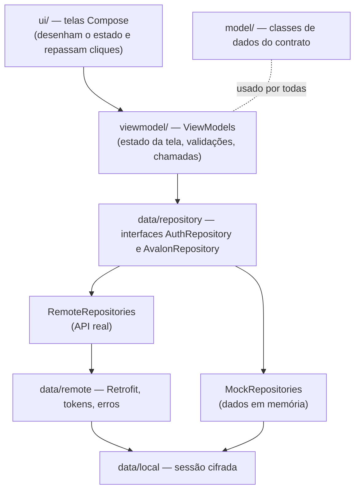
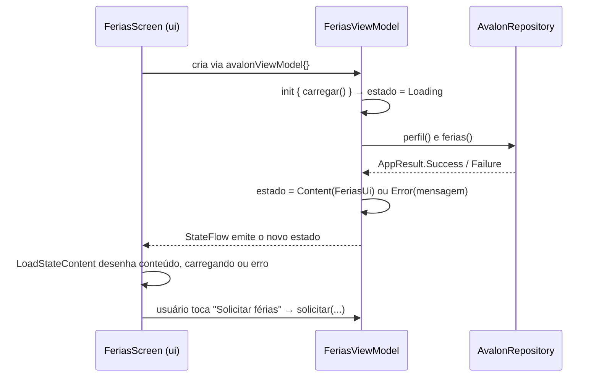
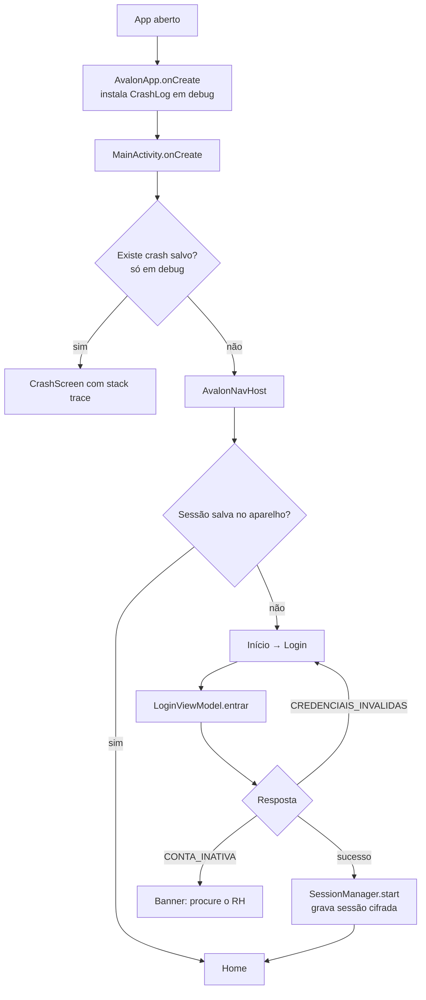

# AVALON Mobile — Documentação do código

Documento de referência do aplicativo Android do AVALON. Explica **o que cada pacote, arquivo, classe e função faz e por que existe**, e como as peças se conectam. O código-fonte não tem comentários explicativos de propósito: toda a explicação está aqui.

> **Como ler:** a seção 1 dá a visão geral em 5 minutos. A seção 2 mostra a arquitetura e os fluxos. As seções 3 a 10 descrevem o projeto arquivo por arquivo, na mesma ordem das pastas. A seção 11 traz as receitas para alterar o app (nova tela, nova rota da API, desligar o modo demonstração).

---

## Sumário

1. [Visão geral](#1-visão-geral)
2. [Arquitetura e fluxos](#2-arquitetura-e-fluxos)
3. [Configuração do projeto (Gradle e Manifest)](#3-configuração-do-projeto)
4. [Recursos (`res/`)](#4-recursos-res)
5. [Raiz do pacote: `AvalonApp` e `MainActivity`](#5-raiz-do-pacote)
6. [Pacote `model`](#6-pacote-model)
7. [Pacote `data`](#7-pacote-data)
8. [Pacote `viewmodel`](#8-pacote-viewmodel)
9. [Pacote `ui`](#9-pacote-ui)
10. [Pacotes `navigation` e `util`](#10-pacotes-navigation-e-util)
11. [Receitas: como alterar o app](#11-receitas)
12. [Testes](#12-testes)
13. [Divergências conhecidas (Figma × contrato × app)](#13-divergências-conhecidas)
14. [Glossário](#14-glossário)

---

## 1. Visão geral

| Item | Valor |
|---|---|
| Plataforma | Android, `minSdk 27` (Android 8.1), `targetSdk 36` |
| Linguagem / UI | Kotlin + Jetpack Compose (Material 3) |
| Pacote | `com.example.avalon_mobile` |
| Público | Somente o perfil **Colaborador** (Gestor e RH usam a aplicação Web) |
| Rede | Retrofit + OkHttp + Gson, seguindo o contrato `openapi.yaml` v2.1.0 do repositório de Back-end |
| Modo demonstração | `USE_MOCK_API = true` (padrão): dados em memória, sem servidor |

### O que o app faz

| Sprint | Funcionalidades (numeração do Planejamento de Sprints) |
|---|---|
| 1 | Abertura (6.1) e login com validação de status da conta (6.2.1) |
| 2 | Recuperação de senha (6.2.2), sessão segura com renovação de token (6.2.3), Perfil (6.5.1), Jornada e escala (6.5.3) |
| 3 | Férias: consulta e solicitação (6.4); Documentos e holerites (6.5.4); correção cadastral (6.5.2); Feedbacks (6.7); Benefícios |
| 4 | Pesquisas e avaliação psicossocial com alerta de obrigatórias (6.6); Home com indicadores e atalhos (6.3.1, 6.3.3); mural de avisos (6.3.2); notificações (6.3.4) |

### Executar

1. Abrir a pasta do projeto no Android Studio e rodar o módulo `app`.
2. Login de demonstração: `ana.lucia` / `123456`. O login `inativo` / `123456` demonstra conta inativa.
3. Para usar a API real: em `app/build.gradle.kts`, `USE_MOCK_API = false` e `API_BASE_URL` com o endereço da API.

---

## 2. Arquitetura e fluxos

### 2.1 Camadas

O app segue o padrão **MVVM** (Model–View–ViewModel) com repositórios. Cada camada só conhece a camada imediatamente abaixo:

| Camada | Responsabilidade | Não faz |
|---|---|---|
| `ui` | Desenhar o estado recebido e avisar o ViewModel sobre ações do usuário | Não chama API nem guarda regra de negócio |
| `viewmodel` | Guardar o estado da tela (`StateFlow`), validar entradas, chamar o repositório | Não conhece Retrofit nem Compose |
| `data/repository` | Esconder de onde vêm os dados (mock ou API) atrás de uma interface | Não desenha nada |
| `data/remote` | Montar requisições HTTP, anexar e renovar o token, traduzir erros | Não decide o que mostrar |
| `data/local` | Guardar a sessão cifrada no aparelho | — |
| `model` | Definir o formato dos dados (iguais aos JSONs do contrato) | Não tem lógica, salvo propriedades derivadas simples |

**Por que assim:** trocar o modo demonstração pela API real exige mudar só uma flag (`USE_MOCK_API`), porque telas e ViewModels dependem das interfaces, não das implementações.

### 2.2 Ciclo de uma tela

Todas as telas seguem o mesmo ciclo. Exemplo com a tela Férias:

### 2.3 Fluxo de abertura e login

### 2.4 Fluxo do token (Sprint 2 — 6.2.3)

1. O login devolve `access_token` (vida curta, `expires_in` segundos) e `refresh_token` (uso único).
2. `SessionManager.start` calcula a hora de expiração e grava tudo cifrado (`SecureSessionStore`).
3. Toda requisição passa pelo `AuthInterceptor`, que anexa `Authorization: Bearer <token>`. Se faltar menos de 60 s para expirar, renova **antes** de enviar.
4. Se o servidor ainda assim responder 401, o `TokenAuthenticator` renova uma vez e repete a requisição.
5. A renovação (`TokenRefresher.refresh`) é sincronizada: várias requisições que expiram juntas geram **um** único refresh. Isso é obrigatório porque o contrato revoga toda a sessão se um refresh já usado for reapresentado.
6. Se a renovação for negada, `SessionManager.expire()` apaga a sessão e emite `expired`. O `AvalonNavHost` escuta esse evento e leva o usuário ao Login com o aviso "Sua sessão expirou".

### 2.5 Mapa de rotas

| Rota | Tela | Barra inferior (aba destacada) |
|---|---|---|
| `inicio` | `InicioScreen` | — |
| `login` | `LoginScreen` | — |
| `recuperar/codigo` | `CodigoRecuperacaoScreen` | — |
| `recuperar/redefinir/{token}` | `RedefinirSenhaScreen` | — |
| `home` | `HomeScreen` | Home |
| `pesquisas` | `PesquisasScreen` | Pesquisas |
| `documentos` | `DocumentosScreen` | Documentos |
| `perfil` | `PerfilScreen` | Perfil |
| `jornada` | `JornadaScreen` | Perfil |
| `ferias` | `FeriasScreen` | Home |
| `beneficios` | `BeneficiosScreen` | Home |
| `downloads` | `DownloadsScreen` | Documentos |
| `feedbacks` | `FeedbacksScreen` | Home |
| `feedback/{id}` | `FeedbackDetalheScreen` | — |
| `pesquisa/{id}` | `PesquisaScreen` | — |
| `avaliacao` | `AvaliacaoScreen` | — |
| `notificacoes` | `NotificacoesScreen` | Home |
| `comunicados` | `ComunicadosScreen` | Home |
| `mais` | `MaisScreen` | Home |
| `privacidade` / `termos` | `InfoScreen` | Perfil |

Telas sem barra inferior são fluxos que o usuário deve concluir ou cancelar (login, responder pesquisa, responder feedback).

### 2.6 Telas × endpoints do contrato

| Tela | Endpoint(s) usados no modo API real |
|---|---|
| Login | `POST /auth/login` |
| Esqueci minha senha | `POST /auth/senha/esqueci` |
| Redefinir senha | `POST /auth/senha/redefinir` |
| Sair | `POST /auth/logout` |
| Home | `GET /dashboard`, `GET /feedback`, `GET /notificacao` |
| Perfil | `GET /colaborador/{id}` |
| Jornada | `GET /colaborador/{id}` → `GET /jornada_escala/{id}` → `GET /jornada_escala/{id}/dias` |
| Férias | `GET /ferias?id_colaborador=`, `POST /ferias` |
| Benefícios | `GET /colaborador/{id}/beneficio` |
| Documentos / Downloads | `GET /documento?id_colaborador=`, `GET /documento/{id}/arquivo` |
| Feedbacks | `GET /feedback?id_colaborador_destinatario=`, `GET/POST /feedback/{id}/resposta` |
| Pesquisas | `GET /pesquisa`, `GET /pesquisa?somente_pendentes=true`, `GET /pesquisa/{id}`, `GET /pesquisa/{id}/pergunta`, `POST /pesquisa/{id}/resposta` |
| Avaliação psicossocial | `GET /avaliacao?somente_pendentes=true`, `GET /avaliacao/{id}/pergunta`, `POST /avaliacao/{id}/resposta` |
| Notificações | `GET /notificacao` |

Todos os caminhos têm o prefixo `/v1/senai/avalon`.

---

## 3. Configuração do projeto

### `gradle/libs.versions.toml`

Catálogo central de versões de bibliotecas. Bibliotecas adicionadas para o app:

| Biblioteca | Para que serve |
|---|---|
| `androidx.lifecycle:lifecycle-viewmodel-compose` | Criar ViewModels dentro de telas Compose (`viewModel(...)`) |
| `androidx.lifecycle:lifecycle-runtime-compose` | `collectAsStateWithLifecycle()`: lê o `StateFlow` só enquanto a tela está visível |
| `androidx.navigation:navigation-compose` | Navegação entre telas por rotas de texto |
| `com.squareup.retrofit2:retrofit` | Transforma a interface `AvalonApi` em chamadas HTTP |
| `com.squareup.retrofit2:converter-gson` | Converte JSON ↔ classes Kotlin |
| `com.squareup.okhttp3:okhttp` | Cliente HTTP usado pelo Retrofit (interceptadores, timeouts) |
| `com.squareup.okhttp3:logging-interceptor` | Log das requisições em debug |

### `app/build.gradle.kts`

| Trecho | Função |
|---|---|
| `buildConfigField("String", "API_BASE_URL", ...)` | Endereço da API. `10.0.2.2` é o "localhost do computador" visto de dentro do emulador. Em celular físico, trocar pelo IP da máquina que roda a API |
| `buildConfigField("boolean", "USE_MOCK_API", "true")` | `true` = dados de demonstração; `false` = API real |
| `buildFeatures { buildConfig = true }` | Gera a classe `BuildConfig` com os dois campos acima |
| `implementation(...)` | Declara as bibliotecas do catálogo |

### `app/src/main/AndroidManifest.xml`

| Elemento | Função |
|---|---|
| `uses-permission INTERNET` | Permite acessar a API |
| `android:name=".AvalonApp"` | Usa a classe `AvalonApp` como `Application` (ponto de partida do processo) |
| `android:networkSecurityConfig` | Aponta as regras de HTTP/HTTPS (ver `res/xml`) |
| `android:windowSoftInputMode="adjustResize"` | O conteúdo encolhe quando o teclado abre, para os campos não ficarem escondidos |
| `<provider FileProvider>` | Permite entregar o PDF baixado para outro app (leitor de PDF) com segurança |

---

## 4. Recursos (`res/`)

| Pasta / arquivo | Conteúdo e motivo |
|---|---|
| `font/inter_*.ttf` (5 pesos) | Fonte do corpo do texto no Figma. Empacotada no APK para funcionar sem internet no auditório |
| `font/actor_regular.ttf` | Fonte dos títulos e botões do Figma |
| `font/bruno_ace_sc_regular.ttf` | Fonte do logotipo "AVALON" |
| `drawable/avalon_sphere.xml` | Esfera geodésica do logotipo (vetor gerado a partir do Figma) |
| `drawable/ic_*.xml` (36 arquivos) | Ícones Lucide usados no Figma (casa, sino, cadeado...), convertidos em vetor Android. O nome do arquivo é o nome do ícone no Lucide |
| `drawable/ic_launcher_*.xml`, `mipmap-*` | Ícone do app na tela inicial do Android (padrão do template) |
| `values/strings.xml` | Nome do app ("AVALON") |
| `values/colors.xml` | Cor azul-marinho usada no fundo da janela antes do Compose desenhar |
| `values/themes.xml` | Tema da janela: fundo azul-marinho, sem barra de ação |
| `xml/network_security_config.xml` | **Release:** só HTTPS, exceto `10.0.2.2` e `localhost` |
| `debug/res/xml/network_security_config.xml` | **Debug:** libera HTTP em qualquer endereço (API rodando na rede local) |
| `xml/backup_rules.xml`, `xml/data_extraction_rules.xml` | Tiram a sessão cifrada do backup do Android. A chave de cifra não é copiada para outro aparelho, então restaurar o arquivo só geraria uma sessão ilegível |
| `xml/file_paths.xml` | Pasta (`cache/documentos/`) que o `FileProvider` pode compartilhar |

---

## 5. Raiz do pacote

### `AvalonApp.kt`

Classe `Application`: o primeiro código executado quando o processo do app nasce.

| Membro | O que faz |
|---|---|
| `container` | Cria o `AppContainer` (todas as dependências) **só no primeiro uso** (`by lazy`). Assim, uma falha na criação é capturada pelo `CrashLog` em vez de impedir a abertura |
| `onCreate()` | Em build de debug, instala o `CrashLog` |

### `MainActivity.kt`

Única tela (`Activity`) do app; todas as "telas" são composables trocados pela navegação.

| Linha / trecho | O que faz |
|---|---|
| `enableEdgeToEdge(...)` | Desenha por baixo das barras do sistema e deixa os ícones do relógio/bateria claros (os cabeçalhos são azul-marinho) |
| `CrashLog.ler(this)` | Em debug, verifica se houve crash na execução anterior |
| `setContent { ... }` | Se houve crash, mostra `CrashScreen`; senão, aplica o tema e abre o `AvalonNavHost` |

---

## 6. Pacote `model`

Classes de dados com o mesmo formato dos JSONs do contrato. `@SerializedName("nome_no_json")` liga o nome em `snake_case` do JSON ao nome em `camelCase` do Kotlin. Campos marcados como **(fora do contrato)** aparecem no Figma, mas ainda não existem na API; são opcionais (`null`) e só aparecem na tela se o Back-end passar a enviar.

### `Auth.kt`

| Classe | Uso |
|---|---|
| `LoginRequest(login, senha)` | Corpo de `POST /auth/login` |
| `RefreshRequest(refreshToken)` | Corpo de `POST /auth/refresh` |
| `LogoutRequest(refreshToken)` | Corpo de `POST /auth/logout` |
| `EsqueciSenhaRequest(login)` | Corpo de `POST /auth/senha/esqueci` |
| `RedefinirSenhaRequest(token, novaSenha, confirmacaoNovaSenha)` | Corpo de `POST /auth/senha/redefinir` |
| `TokenResponse` | Resposta do login/refresh: tokens, validade (`expiresIn` em segundos), usuário e menus |
| `UsuarioResumo` | Quem está logado: id, login, id do colaborador, nome e nível de acesso |
| `NivelAcesso` | Perfil (`COLABORADOR = 1`, `GESTOR = 2`, `RH = 3`, regra RN 12.1.2) |
| `Menu` | Item de menu devolvido pelo login (não usado no mobile, previsto no contrato) |
| `MeResponse` | Resposta de `GET /auth/me` |
| `ApiErro`, `ErroDetalhe` | Envelope de erro padrão do contrato (`codigo`, `mensagem`, `detalhes`) |

### `Colaborador.kt`

| Membro | Uso |
|---|---|
| `Colaborador` | Cadastro do titular. `ghe` é **(fora do contrato)** |
| `cpfMascarado` | Mostra só os dígitos do meio e do fim: `•••.482.•••-10` |
| `iniciais` | Primeira letra do primeiro e do último nome, usadas no avatar |
| `SolicitacaoCorrecao(campo, valorSugerido, justificativa)` | Pedido de correção cadastral (RF-006) |

### `Jornada.kt`

| Classe | Uso |
|---|---|
| `JornadaEscala` | Turno: nome, `horaInicio`, `horaFim` (formato `HH:MM:SS`) |
| `DiaSemana` | Dia da escala com `diaSigla` (`SEG`...`DOM`) e `ativo` (trabalha ou folga) |

### `Ferias.kt`

| Membro | Uso |
|---|---|
| `Ferias` | Pedido de férias. `dataSolicitacao` é **(fora do contrato)** |
| `situacao` | Converte o status do contrato no rótulo do Figma |
| `FeriasRequest` | Corpo de `POST /ferias` |
| `SituacaoFerias.from(status)` | `Aprovado pelo RH` → Aprovado; `Recusado pelo Gestor/RH` → Negado; o resto (`Pendente`, `Aprovado pelo Gestor`) → Em análise. O fluxo do contrato tem duas etapas (Gestor → RH) |

### `Beneficio.kt`

| Classe | Uso |
|---|---|
| `Beneficio` | Item do catálogo (nome, descrição, disponibilidade) |
| `BeneficioColaborador` | Concessão do benefício ao titular |
| `BeneficioItem(beneficio, aderido)` | Formato que a tela consome: o benefício e se o titular tem adesão ativa |

### `Documento.kt`

| Membro | Uso |
|---|---|
| `Documento` | Documento do titular. `ativo = false` = indisponibilizado pelo RH. `dataDisponibilizacao`, `tamanhoBytes`, `lido` são **(fora do contrato)** |
| `assinado` | `true` para Contrato, Termo, Aditivo e Política (seção "Documentos Assinados" em Downloads); o resto vai para "Extratos" |

### `Feedback.kt`

| Classe | Uso |
|---|---|
| `Feedback` | Feedback recebido. `remetenteNome`, `remetenteCargo`, `lido` são **(fora do contrato)** |
| `RespostaFeedback` | Resposta do titular |
| `RespostaFeedbackRequest(descricao)` | Corpo de `POST /feedback/{id}/resposta` |

### `Pesquisa.kt`

| Classe | Uso |
|---|---|
| `Pesquisa` | Pesquisa de experiência. `totalPerguntas`, `respondida`, `dataResposta` são **(fora do contrato)** |
| `Pergunta` | Pergunta da pesquisa. `isEscala` = tipo `ESCALA` (nota 1–5); senão é texto livre |
| `RespostaPesquisaItem`, `RespostaPesquisaLote` | Envio de todas as respostas de uma vez (`POST /pesquisa/{id}/resposta`) |
| `Avaliacao` | Avaliação de fatores psicossociais (NR-1) |
| `AvaliacaoPergunta` | Pergunta da avaliação; pertence a um fator (`idFator`) |
| `RespostaAvaliacaoItem`, `RespostaAvaliacaoLote` | Envio em lote da avaliação |
| `RespostaConfirmacao` | Confirmação **sem identificadores**: só a quantidade gravada. Garante o anonimato |

### `Notificacao.kt`

| Classe | Uso |
|---|---|
| `Notificacao` | Aviso do sistema. `tipoOrigem` diz o módulo (`FERIAS`, `PESQUISA`...). `lida` e `dataHora` são **(fora do contrato)**: o banco não tem essas colunas |
| `Dashboard`, `DashboardColaborador` | Contadores da Home (`GET /dashboard`) |
| `Comunicado` | Item do mural de avisos (sem rota no contrato) |

---

## 7. Pacote `data`

### `AppResult.kt`

Padroniza o retorno de qualquer operação de dados.

| Membro | O que é |
|---|---|
| `AppResult.Success(data)` | Deu certo; carrega o dado |
| `AppResult.Failure(error)` | Deu errado; carrega um `AppError` |
| `AppError(codigo, mensagem, httpStatus)` | `codigo` segue a tabela de erros do contrato (ex.: `CONTA_INATIVA`); `mensagem` já está pronta para mostrar ao usuário |
| `SEM_CONEXAO`, `NAO_IMPLEMENTADO`, `DESCONHECIDO` | Códigos internos para falhas que não vêm do servidor |
| `map { }` | Transforma o dado de um `Success` sem precisar tratar o `Failure` |

**Por que existe:** os ViewModels nunca recebem exceções; recebem sempre um `AppResult` e decidem o que mostrar.

### `AppContainer.kt`

"Fábrica" que cria cada dependência uma única vez e as entrega prontas (injeção de dependência manual).

| Membro | O que faz |
|---|---|
| `appScope` | Escopo de corrotinas que vive enquanto o app vive |
| `gson` | Conversor JSON compartilhado |
| `sessionManager` | Sessão do usuário (ver `data/local`) |
| `pdfFactory` | Gerador de PDF (ver `util`) |
| `logging` | Log HTTP em debug: **só cabeçalhos**, porque o corpo do login contém a senha; e esconde o cabeçalho `Authorization` |
| `baseClient` | Cliente HTTP com timeouts (15 s para conectar, 30 s para ler) |
| `retrofit(client)` | Monta o Retrofit com a URL do `BuildConfig` e o conversor Gson |
| `refresher` | Renovador de token. Usa um cliente **sem** autenticador para não entrar em laço infinito |
| `api` | A `AvalonApi` com o interceptador (anexa o token) e o autenticador (renova em 401) |
| `apiCall` | Tradutor de respostas HTTP para `AppResult` |
| `authRepository`, `avalonRepository` | Escolhe Mock ou Remote conforme `USE_MOCK_API` |

### `data/local/SecureSessionStore.kt`

Guarda a sessão no aparelho de forma cifrada (6.2.3).

| Membro | O que faz |
|---|---|
| `Session` | O que é guardado: tokens, instante de expiração e o usuário |
| `read()` | Lê e decifra. Se não conseguir (chave invalidada, arquivo corrompido), apaga e devolve `null` em vez de travar o app |
| `write(session)` | Converte para JSON, cifra e grava. Se o Keystore do aparelho falhar, registra no log e devolve `false`: o login continua, com a sessão só em memória |
| `clear()` | Apaga a sessão |
| `secretKey()` | Busca (ou cria na primeira vez) a chave AES-256 no **Android Keystore**. A chave fica no hardware/sistema e não pode ser exportada |
| `encrypt(plain)` | Cifra com AES/GCM. O Keystore gera um vetor de inicialização (IV) aleatório, que é gravado junto: `Base64(IV + texto cifrado)` |
| `decrypt(blob)` | Separa os 12 primeiros bytes (IV) do resto e decifra |

### `data/local/SessionManager.kt`

Fonte única da sessão em memória, sincronizada com o `SecureSessionStore`.

| Membro | O que faz |
|---|---|
| `session` | `StateFlow` com a sessão atual; quem observa é avisado de login/logout |
| `expired` | Evento disparado quando a sessão cai **sem** o usuário pedir (refresh negado) |
| `current` | Valor atual da sessão |
| `start(response)` | Após login/refresh: calcula `expiresAtMillis = agora + expires_in × 1000`, grava e publica |
| `end()` | Logout voluntário: apaga e publica `null` |
| `expire()` | Logout forçado: igual ao `end()`, mais o evento `expired` |
| `needsRefresh()` | `true` se faltar menos de 60 s para o token expirar |

### `data/remote/AvalonApi.kt`

Interface Retrofit: cada função é uma rota do contrato (ver tabela 2.6). `@GET`/`@POST` definem método e caminho; `@Path` preenche `{id}`; `@Query` vira `?nome=valor`; `@Body` vira o JSON enviado; `@Streaming` baixa o PDF sem carregar tudo de uma vez. `Response<T>` permite ler o código HTTP e o corpo de erro.

`AuthRefreshApi` é separada de propósito: contém só `POST /auth/refresh` e é usada por um cliente HTTP sem renovação automática, para evitar que a própria renovação dispare outra renovação.

### `data/remote/TokenRefresher.kt`

| Classe / função | O que faz |
|---|---|
| `TokenRefresher.refresh(staleAccessToken)` | Renova o token. `@Synchronized` faz chamadas simultâneas esperarem na fila. Se outra thread já renovou enquanto esta esperava, reaproveita o token novo. Sem rede: mantém a sessão. Resposta 401/403: chama `expire()` |
| `AuthInterceptor.intercept` | Executa antes de toda requisição: renova proativamente se `needsRefresh()` e anexa `Authorization: Bearer`. O cabeçalho `X-Avalon-No-Auth` (constante `NO_AUTH_HEADER`) pula esse passo |
| `TokenAuthenticator.authenticate` | Executa quando a resposta é 401: tenta **uma** renovação e repete a requisição. Se já é uma repetição (`priorResponse != null`), desiste e encerra a sessão |
| `Request.withBearer(token)` | Copia a requisição trocando o cabeçalho `Authorization` |

### `data/remote/ApiCall.kt`

| Função | O que faz |
|---|---|
| `execute { api.algo() }` | Executa a chamada e devolve `AppResult`. Sucesso: `Success(corpo)`. HTTP de erro: lê o envelope `Erro`. Sem rede (`IOException`): `SEM_CONEXAO`. Resposta inesperada: `DESCONHECIDO` |
| `parseError(response)` | Extrai `codigo` do JSON de erro; se não houver, usa `NAO_IMPLEMENTADO` (HTTP 501) ou `HTTP_<código>` |
| `mensagemPara(codigo, ...)` | Traduz o código do contrato para a frase mostrada na tela |

### `data/repository/AvalonRepository.kt`

Duas interfaces (contratos internos do app):

- **`AuthRepository`**: `usuario` (quem está logado), `login`, `logout`, `esqueciSenha`, `redefinirSenha`.
- **`AvalonRepository`**: uma função por necessidade de tela — `dashboard`, `comunicados`, `perfil`, `solicitarCorrecao`, `jornada`, `ferias`, `solicitarFerias`, `beneficios`, `solicitarBeneficio`, `documentos`, `baixarDocumento`, `feedbacks`, `respostasFeedback`, `responderFeedback`, `pesquisas`, `pesquisa`, `responderPesquisa`, `avaliacaoPendente`, `perguntasAvaliacao`, `responderAvaliacao`, `notificacoes`.

O escopo (o titular só vê os próprios dados) é garantido pelo servidor.

### `data/repository/RemoteRepositories.kt`

Implementação que fala com a API real.

| Função | Detalhe relevante |
|---|---|
| `RemoteAuthRepository.login` | Recusa logins de Gestor/RH (`PERFIL_NAO_SUPORTADO`): o app é exclusivo do Colaborador |
| `RemoteAuthRepository.logout` | Revoga no servidor e apaga localmente mesmo se a rede falhar |
| `idColaborador` | Pega o id do titular da sessão para montar as consultas |
| `naoDisponivel(...)` | Resposta honesta para funções sem rota no contrato (correção cadastral, adesão a benefício): mensagem de "ainda não possui rota", nunca um falso sucesso |
| `jornada()` | Encadeia três chamadas: colaborador → jornada → dias da jornada |
| `beneficios()` | Usa só as concessões do titular, porque o catálogo completo é exclusivo do RH |
| `pesquisas()` | Busca todas e as pendentes; marca como respondida quem não está na lista de pendentes |
| `perguntasAvaliacao()` | Descarta perguntas inativas e ordena por fator e ordem |

### `data/repository/MockRepositories.kt`

Implementação de demonstração, com as mesmas regras do contrato e os textos do Figma.

| Membro | O que faz |
|---|---|
| `MockAuthRepository.login` | `ana.lucia/123456` entra; `inativo/123456` → `CONTA_INATIVA`; qualquer outro → `CREDENCIAIS_INVALIDAS`. A senha é conferida antes do status, como no contrato. Grava a sessão pelo mesmo armazenamento cifrado da versão real |
| `esqueciSenha` | Sempre sucesso (o contrato nunca revela se o login existe) |
| `redefinirSenha` | Aceita qualquer código de 8 caracteres |
| `LATENCIA` | Atraso artificial (500 ms) para simular a rede e exibir os indicadores de carregamento |
| `MockAvalonRepository` | Guarda estado em memória: pedidos de férias criados, respostas de feedback, pesquisas respondidas |
| `solicitarFerias` | Recusa datas que se sobrepõem a pedidos não recusados (`FERIAS_SOBREPOSTAS`) |
| `responderPesquisa` | Recusa reenvio (`PESQUISA_JA_RESPONDIDA`) e falta de obrigatórias (`RESPOSTA_OBRIGATORIA_AUSENTE`) |
| `baixarDocumento` | Gera um PDF de demonstração com o `PdfFactory` |
| `MockData` | Massa de dados: colaboradora Ana Lucia, jornada seg–sex 08h–17h, 3 pedidos de férias, 5 benefícios, 7 documentos, 3 feedbacks, 4 pesquisas, avaliação NR-1 com 12 perguntas, 4 notificações, 1 comunicado |

---

## 8. Pacote `viewmodel`

Um ViewModel guarda o estado de uma tela e sobrevive à rotação do aparelho. Padrão usado em todos:

- `_state` (privado, `MutableStateFlow`) é alterado só pelo ViewModel; `state` (público, só leitura) é observado pela tela.
- `carregar()` coloca `Loading`, chama o repositório e troca para `Content` ou `Error`.
- Eventos de uma única vez (navegar, abrir PDF, mostrar mensagem) usam `Channel`, para não se repetirem ao girar a tela.
- `viewModelScope.launch` roda a chamada em segundo plano e é cancelado quando a tela é destruída.

### `ViewModelFactory.kt`

| Função | O que faz |
|---|---|
| `avalonViewModel { container, handle -> ... }` | Cria o ViewModel dando acesso ao `AppContainer` e ao `SavedStateHandle` (onde ficam os argumentos da rota, como o `id`) |
| `AppResult.toLoadState()` | Converte `Success`/`Failure` em `Content`/`Error` |

### `AuthViewModels.kt`

| Membro | O que faz |
|---|---|
| `LoginUiState` | Campos digitados, erros por campo, erro geral, `contaInativa`, carregando |
| `LoginEvent` | `Autenticado` (vai para a Home) ou `CodigoEnviado` (vai para a tela do código) |
| `onLoginChange`, `onSenhaChange` | Atualizam o campo e limpam o erro correspondente |
| `entrar()` | Valida campos vazios, chama o login, limpa a senha da memória e trata `CONTA_INATIVA` à parte |
| `esqueciSenha()` | Exige o login preenchido e pede o código ao servidor |
| `RedefinirSenhaViewModel` | Lê o `token` da rota, valida e envia a nova senha |
| `validarPolitica(senha)` | Pré-validação: mínimo 8 caracteres, com letras e números. A política oficial é do Back-end (RF 5.1.41) |

### `PerfilViewModels.kt`

| Membro | O que faz |
|---|---|
| `PerfilViewModel.carregar` | Busca o cadastro |
| `solicitarCorrecao` | Exige valor e justificativa e envia; estado em `CorrecaoState` (`Idle`, `Enviando`, `Enviada`, `Erro`) |
| `sair(onDone)` | Faz logout e avisa a tela para navegar |
| `JornadaViewModel.montarSemana(dias, hoje)` | Monta a semana atual de segunda a domingo e marca cada dia como `HOJE`, `TRABALHO` ou `FOLGA` cruzando com os dias ativos da escala |

### `FeriasViewModel.kt`

| Membro | O que faz |
|---|---|
| `carregar()` | Busca perfil (data de admissão) e pedidos; calcula o saldo com `SaldoFerias` |
| `solicitar(inicio, fim, observacao)` | Valida: início no futuro, fim ≥ início, mínimo de 5 dias (CLT art. 134), dentro do saldo. Envia e recarrega a lista |
| `SolicitacaoState` | `Idle`, `Enviando`, `Enviada`, `Erro` |

### `ConteudoViewModels.kt`

| Membro | O que faz |
|---|---|
| `BeneficiosViewModel` | Lista, filtra (`Todos`/`Aderidos`/`Disponíveis`) e envia pedidos de adesão/cancelamento; o resultado vai para o snackbar |
| `DocumentosViewModel` | Compartilhado por Documentos e Downloads. `buscar` filtra por nome/tipo; `baixar` recusa documentos inativos e emite `DownloadEvent.Abrir` com os bytes do PDF; `exportarPerfil` gera o PDF do perfil no aparelho. `baixando` guarda qual item mostra o indicador de progresso (`PERFIL_ID = -1` para o perfil) |
| `FeedbacksViewModel` | Lista os feedbacks recebidos |
| `FeedbackDetalheViewModel` | Lê o `id` da rota, carrega o feedback e as respostas; `enviar` valida texto (máx. 1000 caracteres) e adiciona a resposta à lista |

### `PesquisaViewModels.kt`

| Membro | O que faz |
|---|---|
| `PesquisasViewModel.carregar` | Separa **pendentes** (não respondida, ativa e dentro do prazo) de **respondidas/encerradas**; inclui a avaliação NR-1 pendente |
| `PesquisaUi` | Perguntas, respostas, pergunta atual, etapa (`PERGUNTAS`, `REVISAO`, `ENVIADA`), alerta de obrigatória, confirmação |
| `responder` | Guarda a resposta da pergunta |
| `proxima()` | Se a pergunta é obrigatória e está vazia, liga o alerta (6.6); senão avança ou vai para a revisão |
| `anterior()` | Volta uma pergunta ou sai da revisão; devolve `false` na primeira pergunta para a tela decidir sair |
| `editar(indice)` | Volta da revisão para uma pergunta e retorna direto à revisão depois |
| `pedirConfirmacao()` / `enviar()` | Bloqueia se faltar obrigatória; envia todas as respostas em lote |
| `ESCALA` | Valores 1–5: Discordo totalmente … Concordo totalmente |
| `AvaliacaoViewModel` | Etapas `INTRO` → `PERGUNTAS` → `ENVIADA`. Envia em lote e **apaga as respostas da memória** após a confirmação (anonimato) |
| `FREQUENCIA` | Valores 1–5: Nunca … Sempre. A interpretação de risco é do servidor (Motor de Regras), nunca do app (RF 1.1.28) |

### `HomeViewModels.kt`

| Membro | O que faz |
|---|---|
| `HomeViewModel.carregar` | Faz 4 consultas em paralelo (`async`): dashboard, feedbacks, notificações e comunicados. Monta `HomeUi` com primeiro nome, contadores e mural |
| `NotificacoesViewModel` | Ordena por mais recente (maior id, RF-504) e agrupa por "Hoje"/"Ontem"/"Recentes" |
| `ComunicadosViewModel` | Lista o mural de avisos |

---

## 9. Pacote `ui`

### `ui/theme`

| Arquivo | Conteúdo |
|---|---|
| `Color.kt` | Todas as cores do Figma com nome semântico (`Navy` = azul-marinho principal, `TextSecondary`, `StatusApprovedBg`...) |
| `Type.kt` | Famílias de fonte (`Inter`, `Actor`, `BrunoAce`) e a tipografia Material com tamanhos do Figma |
| `Theme.kt` | `AVALONMOBILETheme`: esquema de cores fixo, sem tema escuro nem cor dinâmica, para manter a aparência igual ao protótipo e à Web |

### `ui/components` — peças reutilizadas por várias telas

| Componente | O que é |
|---|---|
| `AvalonWordmark` | Logotipo "AVAL◎N" (texto + esfera no lugar do O) em qualquer tamanho |
| `AvalonTopBar` | Cabeçalho azul-marinho com voltar, título, subtítulo e ações opcionais |
| `MainTab` / `AvalonBottomBar` | As 4 abas (Home, Pesquisas, Documentos, Perfil); a ativa fica branca e em negrito |
| `AvalonTextField` | Campo com rótulo acima, borda do Figma, erro abaixo e botão de mostrar/ocultar senha |
| `AvalonPrimaryButton` | Botão azul de 55 dp com indicador de carregamento |
| `AvalonSecondaryButton` | Botão branco com borda |
| `LoadState` | Os três estados de uma tela: `Loading`, `Error`, `Content` |
| `LoadStateContent` | Desenha automaticamente carregando, erro com "Tentar novamente" ou o conteúdo |
| `AvalonCard` | Cartão branco com borda, clicável ou não |
| `StatusPill` | Selo arredondado ("Em análise", "Aderido") |
| `IconTile` | Ícone dentro de um quadrado colorido |
| `SectionTitle`, `LoadingBox`, `ErrorBox`, `EmptyState` | Título de seção, carregando, erro e lista vazia |
| `GradeFixa` | Grade de colunas fixas feita só com `Row`/`Column`. Substitui o `FlowRow`, que é experimental e causou crash por mudar entre versões do Compose |
| `LocalSnackbarHostState` | Acesso global à mensagem temporária (snackbar) da parte de baixo da tela |

### `ui/screens/auth` — Sprints 1 e 2

| Arquivo | Conteúdo |
|---|---|
| `InicioScreen.kt` | Tela de abertura: esfera, nome AVALON e botão "Entrar" |
| `AuthLayout.kt` | Estrutura das telas de acesso: logotipo no topo e folha branca arredondada que rola com o teclado |
| `LoginScreen.kt` | Campos login/senha, banner de erro (`Banner`), "Esqueci minha senha". Escuta `LoginEvent` para navegar. O campo é rotulado "Login" porque o contrato autentica por login, não por e-mail |
| `RecuperarSenhaScreens.kt` | `CodigoRecuperacaoScreen`: campo de 8 caracteres (só letras e números, maiúsculas). `RedefinirSenhaScreen`: nova senha + confirmação |

### `ui/screens/home` — Sprint 4

| Arquivo | Conteúdo |
|---|---|
| `HomeScreen.kt` | Cabeçalho com logotipo e sino (ponto vermelho se há não lidas); saudação; 3 indicadores (`Indicador`); grade de atalhos (`Atalho`, `AtalhosGrid`); comunicados |
| `NotificacoesScreen.kt` | Central de notificações agrupada; o toque leva ao módulo de origem (`iconeOrigem` escolhe o ícone). Também contém `ComunicadosScreen` (mural) |
| `MaisScreen.kt` | Grade com os 10 módulos (`Modulo`), "Sair da Conta" e versão do app |
| `InfoScreen.kt` | Textos de Privacidade/LGPD e Termos de Uso (`Informativo`) |

### `ui/screens/perfil` — Sprints 2 e 3

| Arquivo | Conteúdo |
|---|---|
| `PerfilScreen.kt` | `Cabecalho` (avatar com iniciais), `InformacoesRegistro` (cada `Campo` com cadeado se só leitura), "Solicitar correção" (`CorrecaoDialog`), ajustes (`ItemAjuste`) e confirmação de saída |
| `JornadaScreen.kt` | Semana em chips (`DiaChip`), legenda (`Legenda`) e um cartão por dia com horário ou "Folga" |

### `ui/screens/ferias` — Sprint 3

| Arquivo | Conteúdo |
|---|---|
| `FeriasScreen.kt` | `CartaoSaldo` (saldo, período aquisitivo, limite), botão "Solicitar férias" e `PedidoCard` com selo colorido |
| `SolicitarFeriasSheet.kt` | Diálogo com datas de início e fim (calendário nativo do Android, só datas futuras), contagem de dias e observação |

### `ui/screens/conteudo` — Sprint 3

| Arquivo | Conteúdo |
|---|---|
| `BeneficiosScreen.kt` | Filtros, `BeneficioCard` (ícone escolhido pelo nome em `iconeDo`), "Solicitar Cancelamento"/"Solicitar Adesão" |
| `DocumentosScreens.kt` | `DocumentosScreen` (lista com busca e cadeado nos indisponíveis) e `DownloadsScreen` (perfil completo, assinados, extratos com "Lido/Não lido"). `DownloadEffects` abre o PDF ou mostra erro |

### `ui/screens/feedback` — Sprints 3 e 4

| Arquivo | Conteúdo |
|---|---|
| `FeedbackScreens.kt` | `FeedbacksScreen` (lista com "Não lido") e `FeedbackDetalheScreen` (texto completo, respostas anteriores, campo de resposta). `Remetente` desenha avatar, nome e cargo; `TipoPill` colore o tipo |

### `ui/screens/pesquisa` — Sprint 4

| Arquivo | Conteúdo |
|---|---|
| `PesquisasScreen.kt` | Abas "Pendentes (n)" e "Respondidas"; selo "Anônima"/"Identificada"; cadeado nas encerradas |
| `PesquisaScreen.kt` | Pergunta por pergunta, aviso de obrigatória (`Aviso`), revisão com edição (`Revisao`, `ItemRevisao`), confirmação e tela de concluído (`Concluido`). Confirma antes de sair se há respostas preenchidas |
| `AvaliacaoScreen.kt` | Introdução NR-1 com os avisos de anonimato e de "não é diagnóstico", perguntas de frequência, envio |
| `PesquisaComponents.kt` | `FluxoTopBar` (cabeçalho com X), `ProgressoSegmentado` (barra em segmentos), `OpcaoResposta` (cartão com marcador circular) |

### `ui/screens/debug`

| Arquivo | Conteúdo |
|---|---|
| `CrashScreen.kt` | Só em debug: mostra o erro da execução anterior com botões "Copiar" e "Fechar e continuar" |

---

## 10. Pacotes `navigation` e `util`

### `navigation/AvalonNavHost.kt`

| Membro | O que faz |
|---|---|
| `Routes` | Constantes com o texto de cada rota e funções que montam rotas com argumento (`feedback(id)`) |
| `abaPorRota` | Quais rotas mostram a barra inferior e qual aba fica destacada |
| `irParaAba(route)` | Troca de aba preservando o estado de cada uma (rolagem, filtros) |
| `reiniciarEm(route)` | Limpa toda a pilha de telas (após login, logout ou sessão expirada), para o botão voltar não retornar a telas protegidas |
| `AvalonNavHost` | Escolhe a tela inicial (Home se houver sessão, senão Início); escuta `expired`; monta o `Scaffold` com barra inferior e snackbar; declara cada rota |

### `util`

| Arquivo | O que faz |
|---|---|
| `Datas.kt` | Formatação de datas em pt-BR: `dataCurta` (15/12/2026), `diaMes` (15/12), `mesAno` (03/2026), `intervalo` ("15 a 24/12"), `hora` ("08:00"), `nomeDia` ("Segunda"), `sigla` (SEG…DOM) |
| `SaldoFerias.kt` | Estimativa CLT: 30 dias por período aquisitivo de 12 meses, a gozar nos 12 meses seguintes, descontando pedidos não recusados. **Provisório** até o Back-end expor o saldo oficial |
| `PdfFactory.kt` | Gera PDFs A4 no aparelho: perfil completo e documentos de demonstração |
| `DocumentOpener.kt` | Grava o PDF no cache privado e abre no leitor de PDF do sistema via `FileProvider` |
| `CrashLog.kt` | Só em debug: grava a última exceção não tratada (`instalar`), lê (`ler`) e apaga (`limpar`) |

---

## 11. Receitas

### Ligar a API real

1. Back-end rodando e com as rotas do contrato publicadas (sem `501`).
2. `app/build.gradle.kts`: `USE_MOCK_API` → `"false"`; `API_BASE_URL` → `"http://<IP-da-máquina>:8080/"` (emulador: `10.0.2.2`).
3. Sincronizar o Gradle e rodar.

### Adicionar uma tela nova

1. **Modelo** (se houver dado novo): classe em `model/`, com `@SerializedName` igual ao JSON.
2. **API**: função em `AvalonApi`.
3. **Repositório**: função na interface `AvalonRepository` e implementação em `RemoteAvalonRepository` **e** `MockAvalonRepository` (o projeto só compila com as duas).
4. **ViewModel**: em `viewmodel/`, com `MutableStateFlow<LoadState<...>>` e `carregar()`.
5. **Tela**: em `ui/screens/<módulo>/`, recebendo o ViewModel por `avalonViewModel { c, _ -> NovoViewModel(c.avalonRepository) }` e desenhando com `LoadStateContent`.
6. **Rota**: constante em `Routes`, `composable(...)` no `AvalonNavHost` e, se tiver barra inferior, entrada em `abaPorRota`.

### Regra para componentes

Não usar APIs marcadas como experimentais (`@ExperimentalMaterial3Api`, `@ExperimentalLayoutApi`). Elas mudam de assinatura entre versões e causaram crash (`FlowRow`).

---

## 12. Testes

`app/src/test/.../RegrasClienteTest.kt` testa as regras calculadas no aparelho, sem emulador:

| Teste | Verifica |
|---|---|
| status de férias | Conversão dos 5 status do contrato nos 3 rótulos do Figma |
| saldo | Desconto dos pedidos não recusados do período concessivo (resultado 5 dias com os dados de demonstração) |
| sem período completo | Admissão há menos de 1 ano não gera saldo |
| semana da escala | Marcação de hoje, trabalho e folga |
| política de senha | Rejeita curtas, só letras e só números |
| CPF e iniciais | Máscara `•••.482.•••-10` e iniciais "AS" |
| datas | Formatos "15 a 24/12", "28/12 a 05/01" e "08:00" |

Rodar: Android Studio → clique direito em `test` → **Run Tests**.

---

## 13. Divergências conhecidas

| Tema | Situação | Decisão no app |
|---|---|---|
| Campo de login | Figma diz "E-mail"; contrato usa `login` | Rótulo "Login" |
| Recuperação de senha | Figma não tem tela para informar o login | Usa o login digitado na tela de Login |
| Correção cadastral, adesão a benefício, mural | Sem rota no contrato | Modo API real mostra "ainda não possui rota" |
| Catálogo de benefícios | Restrito ao RH | Aba "Disponíveis" vazia no modo API real |
| GHE, foto, remetente do feedback, lido/não lido, data das notificações, data do pedido de férias | Ausentes no contrato | Campos opcionais, exibidos só se vierem |
| Saldo de férias | Ausente no contrato | Calculado no app (`SaldoFerias`), provisório |
| Escala da pesquisa | Figma mostra 4 opções; contrato pede 1–5 | Incluído "Neutro" como 3 |
| Versões das bibliotecas | Compose (BOM 2024.09) desalinhado com `activity-compose` 1.13 | Pendente: alinhar com teste no Android Studio |

---

## 14. Glossário

| Termo | Significado |
|---|---|
| Composable | Função anotada com `@Composable` que desenha parte da tela |
| `StateFlow` | Valor observável: quando muda, a tela redesenha |
| Corrotina | Tarefa em segundo plano que não trava a tela (`launch`, `async`) |
| Repositório | Classe que entrega dados escondendo se vêm da API ou da memória |
| Mock | Implementação falsa, com dados de demonstração |
| Access token | Credencial curta enviada em toda requisição |
| Refresh token | Credencial de uso único para obter um novo access token |
| Keystore | Cofre de chaves do Android; a chave não sai do aparelho |
| k-anonimato | Resultados só aparecem quando há pelo menos k respondentes |
| Rota | Texto que identifica uma tela na navegação (`ferias`, `pesquisa/3`) |
| Snackbar | Mensagem temporária na parte de baixo da tela |
